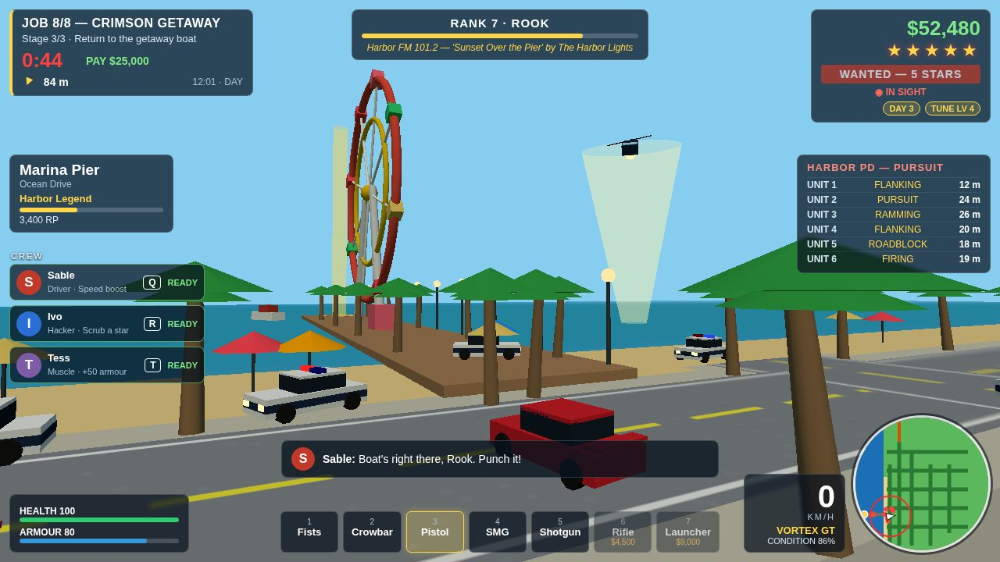

# Crimson Harbor

[](LICENSE)
[](https://threejs.org)
[](#tech-notes)
[](https://make.fun/bounty/gta6-01)
[](https://make.fun/bounty/gta6-01?utm_source=github&utm_medium=readme&utm_campaign=gta6-01)
[](https://make.fun/bounty/gta6-01/leaderboard?utm_source=github&utm_medium=readme&utm_campaign=gta6-01)
[](https://make.fun/bounty/gta6-01?utm_source=github&utm_medium=readme&utm_campaign=gta6-01)

An open-world crime game in a sun-soaked invented coastal city, built for the
[make.fun "Make GTA 6" bounty](https://make.fun/bounty/gta6-01). Drive and walk
through Crimson Harbor, run jobs with your crew, outrun Harbor PD under a
golden-hour sky — and pull off the Crimson Job.



## How to play

No install, no network: serve `game/` with any static file server and open
`index.html` in a desktop browser (Chrome recommended).

```sh
node serve.ts   # serves game/ on http://localhost:8080
```

Click **PLAY** to start the story (Mission 1 begins right away),
**CONTINUE** to load your autosave, or **FREE ROAM** to explore with no
missions. Your progress autosaves every 30 seconds and after every mission.

## Controls

| Key | Action |
| --- | --- |
| W A S D | Drive / walk (A/D steer and turn) |
| Space | Handbrake |
| E | Enter / exit car, interact with mission markers |
| F or mouse click | Attack / fire weapon |
| Q or 1–6 | Cycle / select weapon |
| R | Next radio station |
| Z / X / C | Crew abilities: Mara boost / Dex ghost / Rosa armour |
| M | Start the next mission |
| V | Camera distance |
| Tab | Stats & crew screen |
| P / Esc | Pause |

## Missions

1. **First Gear** — $2,500. Pick up Mara's package at Harbor Market and deliver it to the Palm Row garage.
2. **Salt & Smoke** — $6,000. Steal the Vortex GT from the Coral Ave showroom, lose a 2-star wanted level, deliver to the chop shop.
3. **Night Tide** — $12,000. Meet Dex at the pier, then hit three checkpoints along Ocean Blvd and North Bridge against the clock.
4. **The Crimson Job** — $25,000. Hit the Meridian Bank vault, then escape a 4-star manhunt to the lighthouse drop-off.

## The crew

- **Mara Voss — Driver.** *Slipstream:* +25% top speed for 10 seconds.
- **Dex Marlowe — Hacker.** *Ghost:* drop 1 wanted star instantly.
- **Rosa Delgado — Muscle.** *Adrenal:* restore 50 armour on the spot.

## Features

- A living procedural city: colourful facades, shop signs, awnings, a beach with umbrellas and sunbathers, palms, a pier, a lighthouse and a bridge.
- Traffic and pedestrians with panic behaviour; stealing cars; a 5-star wanted system with ramming cruisers, roadblocks, flanking units and a police helicopter with a visible spotlight beam.
- Four staged story missions with dialogue, timers and pay; a big rectangular minimap; health/armour numbers; rank and RP; six weapon slots; three procedural radio stations plus a synthesized engine and sirens (WebAudio, no audio files).
- A full day/night cycle with golden-hour lighting, long shadows, lit windows, street lamps and neon at night.
- Autosave to localStorage; deterministic screenshot mode (`?shot=drive|foot|chase|mission`) for reproducible captures.

## Tech notes

- **Stack:** three.js 0.160.0 (vendored under `game/vendor/`, UMD build), plain ES modules, no build step, no network requests at runtime.
- **Structure:** `game/index.html` (HUD + menus), `game/src/main.js` (game loop, input, save), `world.js` (city + sky), `vehicles.js` (cars + traffic), `people.js` (pedestrians), `police.js` (wanted + helicopter), `missions.js` (story + crew), `hud.js` (HUD + minimap + stats), `audio.js` (WebAudio synth), `shots.js` (screenshot staging), `util.js` (helpers, procedural portraits and textures).
- **Entry program:** `main.ts` (Node 22, standard library only) copies `game/` and `screenshots/` to the output directory and writes `dossier.json` with the vendored make.fun library. Run it with `MAKEFUN_OUTPUT_DIR=out node main.ts`.
- Everything in the game — city, characters, vehicles, names, story, art, sound and music — is original and procedural; no Rockstar Games name, logo, character, map or asset is used.

## License

MIT — see [LICENSE](LICENSE).

---

Built for the make.fun bounty — [play the competition](https://make.fun/bounty/gta6-01).
New to make.fun? Sign up with my referral link: https://make.fun/r/pmqap4j3
